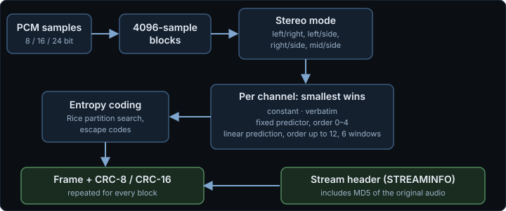
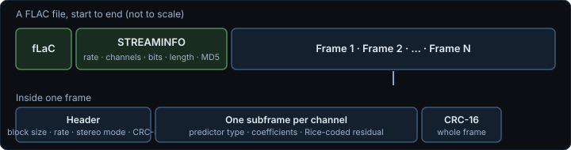
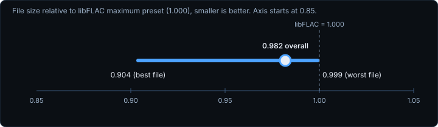
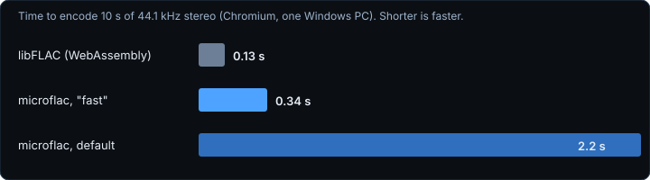

  
  
  
  
  

**microflac.js** is a small FLAC **encoder** written in plain JavaScript. No WebAssembly, no dependencies, no DOM:
it runs in a page, in a Web Worker, or in Node. It squeezes hard by default, and in our tests it produced files
slightly smaller than libFLAC's maximum preset.

> [!NOTE]
> Encoder only. It writes the required header block and frames - no tags, seek table or cover art. See [Known limits](#known-limits).

**Contents:** [Why](#why) · [Quick start](#use) · [Features](#what-it-does) · [Numbers](#numbers-what-we-measured) · [How it works](#how-it-works) · [Tests](#tests) · [Limits](#known-limits) · [Licence](#licence)

## Why

Browsers can **decode** FLAC but cannot **encode** it - WebCodecs has no FLAC encoder. The JavaScript FLAC encoders
we could find ([libflac.js](https://github.com/mmig/libflac.js), [@mediabunny/flac-encoder](https://mediabunny.dev/guide/extensions/flac-encoder),
flac.wasm and similar) are libFLAC compiled to WebAssembly or asm.js, which means shipping a binary next to your page and loading it at run time.

We needed FLAC export for [BOiNK SFX Synth](https://dialersapps.pages.dev/boink.html), wanted **one plain script with nothing to fetch**, and wanted
maximum compression by default. So we wrote our own, and we are releasing it for anyone to use.

| | microflac.js | libFLAC compiled to WebAssembly |
|---|---|---|
| Ships as | one .js file (about 8 KB gzipped) | a JS loader plus a .wasm binary |
| Loading | plain script, ES module, 
equire() | fetch and instantiate the binary |
| File size (our test clips) | 0.982 of libFLAC -8 overall | 1.000 (baseline) |
| Speed, 10 s stereo | about 2.2 s default, 0.34 s "fast" | about 0.13 s |

Speed is where WebAssembly wins; for short clips, or in a Worker, the difference does not matter much. See [Numbers](#numbers-what-we-measured).

## Use

``html

``

ES module (`microflac.mjs`, same code):

``js
import microflac from "./microflac.mjs";          // or: import { encode } from "./microflac.mjs";
``

Node / CommonJS: `const microflac = require("./microflac.js");`

## API

| | |
|---|---|
| `microflac.encode(options)` | Returns a `Uint8Array` with the whole FLAC file. Blocks the thread while it runs - use a Worker for long audio. |
| `microflac.encodeAsync(options)` | Same result (byte-identical), returns a Promise and yields to the event loop between blocks. |
| `microflac.createEncoder(options)` | Streaming input: `write([ch0, ch1, ...])` or `writeInterleaved(typedArray, numChannels)` any number of times, then `finish()` returns the file. |
| `microflac.version` | `"1.0.0"` |

Options:

- `channels`: array of typed arrays, one per channel (all the same length), **or** `interleaved` (one typed array) plus `numChannels`.
- `sampleRate`: integer, 1 to 1048575 (tested 8000 to 48000).
- `bitsPerSample`: `8`, `16` (default) or `24`.
- `level`: `"max"` (default) or `"fast"`.
- `onProgress(fraction)`: called after each block with a value from 0 to 1 (`encode` / `encodeAsync`).

Input conventions: `Float32Array` / `Float64Array` samples are nominally -1 to 1 and are scaled by
`2^(bitsPerSample-1) - 1`, rounded and clamped. Integer arrays (`Int16Array`, `Int32Array`, ...) are used as they
are, clamped to the range of `bitsPerSample`. Anything else throws.

## What it does

Every file has a real STREAMINFO block (min/max block and frame size, total samples and the MD5 of the unencoded
audio), CRC-8 and CRC-16 on every frame, UTF-8 frame numbers and 4096-sample blocks (the last block is shorter).

`level: "max"` per block and channel: all four stereo modes (independent, left/side, right/side, mid/side) chosen
by real encoded size; CONSTANT, VERBATIM, FIXED (orders 0-4) and LPC (orders 1-12) subframes, with LPC tried over
six windows (tukey(0.5), partial_tukey(2), punchout_tukey(3)), Levinson-Durbin and a coefficient-precision search;
wasted-bits detection; an exact Rice partition search (partition order 0-8, both residual coding methods,
escape codes). `level: "fast"` uses one window, LPC order up to 8 and no precision search.

## How it works

Every choice is made by actually encoding the options and keeping the smallest result.

The structure it writes - every frame can be checked on its own, and the MD5 in the header lets any decoder confirm it got exactly the original audio back:

## Numbers (what we measured)

Measured in Chromium on one Windows PC; your numbers will differ.

- **Size of the code**: `microflac.js` is 29.8 KB with the licence header and comments, about 24 KB with comments
  and whitespace stripped (a crude strip, not a real minifier), and 9.9 KB gzipped as shipped (8.0 KB stripped and gzipped).
- **Compression** against libFLAC at its maximum preset (the `-8` equivalent, via libflac.js/WebAssembly) on 6 short
  sound-effect clips from BOiNK's demo set, mono and a synthetic stereo mix, 16 and 24 bit (24 files): microflac's
  files were smaller in every case, 0.904 to 0.999 of libFLAC's size, 0.982 overall. On a 10 s synthetic stereo
  clip the result was 0.975 of libFLAC's size. These are short, mostly noisy-percussive sound effects; we have not
  measured a large corpus of music, so treat the percentages as indicative only.
- **Speed**: a 10 s, 44.1 kHz, 16-bit stereo clip (synthetic tones plus a little noise) encodes in about 2.2 s at
  `"max"` and about 0.34 s at `"fast"`; 10 s mono takes about 0.55 s at `"max"`. libFLAC-in-WebAssembly was about
  17 times faster than `"max"` on the same kind of clip (0.13 s). `"fast"` gave files within about 1% of `"max"` on that clip.
- **Size against raw PCM** on that synthetic clip: 71.8% (`"max"`).

## Tests

Serve this folder with any static server and open `test.html` (the ES-module check needs http, not file://). It
runs 311 checks with the "also test level fast" box ticked (167 without). Each encoded file is verified by an independent
reference decoder written for the page (bit-exact; also checks both CRCs and every STREAMINFO field), by a second MD5
implementation against the STREAMINFO MD5, and by the browser's own `decodeAudioData`. Cases: silence, full-scale
square wave, white noise and sine; lengths 1, 2, 4095, 4096, 4097 and 4608 samples; mono and stereo; 8, 16 and 24 bit;
both levels; nine sample rates; 3 and 6 channels (reference decoder only); integer and interleaved input; streaming and
async APIs; the ES module build; bad-option errors. All passed at the time of writing in Chromium.

## Known limits

- Encoder only. The output has a STREAMINFO block and nothing else: no tags, seek table or cover art.
- 8, 16 and 24 bits per sample only (no 32-bit, no 12/20-bit). 1 to 8 channels; stereo decorrelation applies to 2 channels only.
- Fixed block size of 4096 (so streamable-subset compliant up to 48 kHz). The whole file is built in memory.
- Tested with Chromium's decoder and the reference decoder in `test.html`, on our own sound-effect clips and the
  edge-case suite above. Not tested against the `flac` command-line tool, other players, or a large independent audio corpus.
- Slower than libFLAC compiled to WebAssembly (see above); on very long audio use a Worker and `encodeAsync` / `createEncoder`.

## Where the code comes from

microflac.js was written from scratch against the published FLAC format specification (RFC 9639) and general
signal-processing knowledge (autocorrelation, Levinson-Durbin recursion, Tukey windows, Rice coding, MD5 as in RFC 1321).
It is not derived from libFLAC or from any other FLAC encoder, and it contains no code copied from another project.
Like most FLAC encoders it follows well-documented FLAC practice: the 4096-sample block, the three apodization window
families listed above and a precision that depends on block size are conventional choices, implemented independently.

## Licence

MIT, see [`LICENSE`](LICENSE). Copyright (c) 2026 Dialer's Apps.

Made by [Dialer's Apps](https://dialersapps.pages.dev/). Read the story behind it in the
[blog post](https://dialersapps.pages.dev/lab/notes/microflac.html).